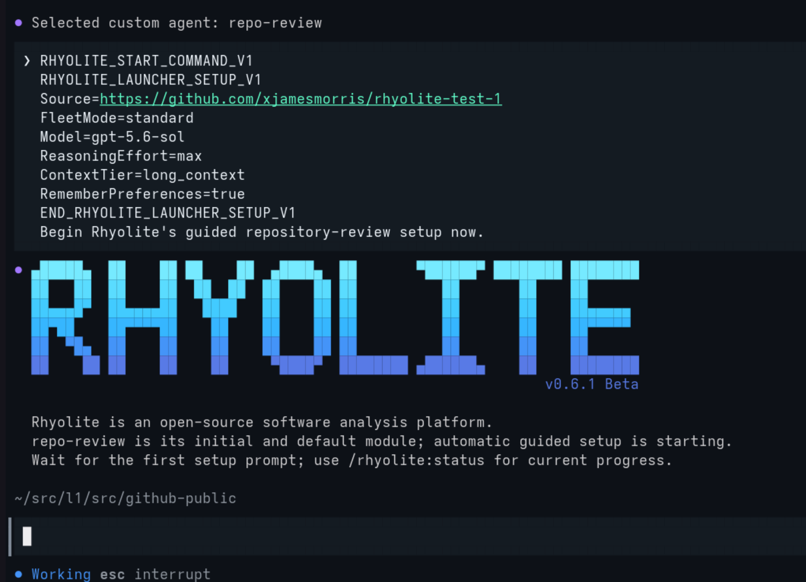

# Rhyolite

Rhyolite is an open-source software analysis platform. `repo-review` is its
initial and default module and is currently the only shipped module.
This release is delivered as a GitHub Copilot plugin and a Claude Code
plugin with a launcher-driven OpenAI Codex CLI path, and production runtime
harness support covers GitHub Copilot CLI, Claude Code, and OpenAI Codex CLI.



For more screenshots of setup, plan approval, and progress in Claude Code and
GitHub Copilot CLI, see [Screencaps](SCREENCAPS.md).

For example output, see this
[sample scope 3 review](docs/sample-reviews/astra-6-rhyolite-test-1-review.md)
of the public `rhyolite-test-1` test repository.

## Quickstart

Requirements: Linux with Bash (validated on Fedora Linux 44), GitHub
Copilot CLI, Claude Code, or OpenAI Codex CLI 0.163.0, Git 2.41 or newer,
Python 3, and curl. The steps below use GitHub Copilot CLI, the default
harness.

Other Fedora versions and Linux distributions may work, but all validation
so far has been on Fedora Linux 44. Contributions and test reports from
other Linux flavors are welcome; see [Contributing](CONTRIBUTING.md).

1. Sign in to GitHub Copilot from a directory outside every Git worktree:

   ```bash
   copilot login
   ```

2. Clone Rhyolite and launch a review of an anonymously readable public
   HTTPS Git repository:

   ```bash
   git clone https://github.com/xjamesmorris/rhyolite
   cd rhyolite
   ./rhyolite --repo https://github.com/owner/repository
   ```

   To review several repositories in one run, list every URL, for example
   `./rhyolite --repo https://github.com/owner/one https://github.com/owner/two`.

3. Press Enter at each launcher prompt to accept the default model,
   reasoning effort, context, and
   [security scans](#multi-model-security-scans), or add `--auto-defaults`
   to accept every default without a prompt. Copilot CLI then opens with
   the `repo-review` agent selected and starts guided setup, as in the
   screenshot above.
4. If you did not use `--auto-defaults`, answer the numbered setup questions
   for the output location and review scope. Choose
   `Scope 1 - Core repository review` for your first run.
5. Check the `EFFECTIVE REVIEW PLAN`, then select `Run review`.
6. While the review runs, type `/rhyolite:status` to check progress, or
   `stop` to cancel it.
7. When it completes, read the `RHYOLITE EXECUTIVE SUMMARY`, then open
   `index.html` in the printed run output folder to browse every report.

Run `./rhyolite --help` for launcher options such as `--yolo` and
`--allow-unlisted-model`; [Install for development](#install-for-development)
describes them in detail. To use the published marketplace instead, follow
[Install from a published marketplace](#install-from-a-published-marketplace),
then start a new Copilot CLI session from a directory outside every Git
worktree and type `/rhyolite:start`.

To review with Claude Code instead, sign in with `claude auth login` and run
`./rhyolite --harness claude --repo https://github.com/owner/repository`;
[Use with Claude Code](#use-with-claude-code) describes the differences.

To review with OpenAI Codex CLI, configure its model provider as described
in [Use with OpenAI Codex CLI](#use-with-openai-codex-cli), export the
provider's key, and run
`./rhyolite --harness codex --repo https://github.com/owner/repository`.

## What's included

The current plugin combines:

- The `repo-review` command agent, write-disabled main review worker, and
  dedicated write-disabled research worker.
- Stable namespaced commands: `/rhyolite:start`,
  `/rhyolite:repo-review`, `/rhyolite:status`, `/rhyolite:version`, and
  `/rhyolite:help`.
- The short `/repo-review` guided-start command when extension commands
  are available.
- Claude Code agents, commands, and display-only hooks registered by
  `plugins/rhyolite/.claude-plugin/plugin.json`.
- A Linux Bash launcher that collects public sources and the review model
  before selecting the restricted
  agent from a clean non-Git orchestration directory.
- The `readonly-repository-review` skill.
- A private `research-source-assessment` skill that maps fresh,
  subject-specific community, research, and commercial sources.
- A Bash review runner for the supported Linux workflow.
- A standalone `rhyolite-summary` utility that scans saved review output into
  portable JSON, Markdown, text, or inert HTML summary tables.
- A deterministic local stdio MCP research-egress broker implemented with the
  Python 3 standard library under a fixed immutable transport safety floor.
- Separate security and dedicated public-source research passes.
- Centralized welcome branding plus Linux onboarding helpers.
- Local display-only hooks for one load notice or exactly-once launcher
  plaque plus exact manual review-start plaques.
- Persisted plain-text, Markdown, HTML, session, state, and handoff
  artifacts.

## Status

Rhyolite currently uses a temporary user-facing `Beta` suffix: a machine
version `X.Y.Z` is displayed as `vX.Y.Z Beta`. GitHub Copilot plugins are
currently public-preview features.

The plugin supports anonymously readable public HTTPS Git repositories on
GitHub and other public DNS hosts. It does not review authenticated,
private, or internal repositories, execute target code, modify target
repositories, or use shared service credentials. Scope 2/3 research uses only
the bundled local broker's public-HTTPS direct-fetch, anonymous GitHub, and
fixed anonymous `duckduckgo-html-v1` general-web-search providers. Advanced
direct-runner use may select explicit `none` to opt out; no other web-search
provider or endpoint is configurable.

**Platform support:** Fedora Linux 44 is the sole development and
validation baseline for this release. Runtime support is Linux-only.
Other Fedora versions and Linux distributions may work, but all validation
so far has been on Fedora Linux 44. Contributions and test reports from
other Linux flavors are welcome; this does not imply validated support.
Non-Linux operating systems remain unsupported. See
[docs/PLAN-OF-RECORD.md](docs/PLAN-OF-RECORD.md).

**Review harness support:** GitHub Copilot CLI (`copilot`, the default),
Claude Code (`claude`, selected with `--harness claude`), and OpenAI Codex
CLI (`codex`, selected with `--harness codex`) are the production runtime
harnesses. See [Use with Claude Code](#use-with-claude-code) and
[Use with OpenAI Codex CLI](#use-with-openai-codex-cli) for their
differences. The harness abstraction is a fixed, fail-closed internal seam;
it does not make other CLIs supported.

Rhyolite is licensed under the GNU General Public License version 2
only (`GPL-2.0-only`). See [LICENSE](LICENSE).

## Quick notes

- Recommended models: use a current frontier reasoning model at the
  maximum available reasoning effort and context (as of October 7, 2026,
  examples include GPT-5.6 Sol, Claude Opus 5.5, and Claude Fable 5.1).
- Sign in before starting a review: run `copilot login` for GitHub Copilot
  CLI, or `claude auth login` for Claude Code. For OpenAI Codex CLI,
  configure its model provider and export the provider's key.
- Use the issue templates in this repository and [SUPPORT.md](SUPPORT.md)
  for questions and feature requests.
- Contributors should start with [Development](#development).
- Scope `3` is evidence-based provenance review for agentically generated
  code. It is separately opt-in and requires human review before sharing.
  It also covers code and architecture lineage, and its generation
  assessment includes documentation and proposal material.
- **Strongly recommended:** select `1 - Core repository review` for the
  first run; broader scopes can be resource-intensive and long-running.

## Known limitations

- **Security-file coverage:** the security pass must inspect every
  security-relevant tracked file, but the runner does not independently
  verify which files the worker opened. Reports may omit unopened files
  from their limitations. A clean report means no qualifying defects were
  identified, not proof of exhaustive coverage or absence of vulnerabilities.
- **Host sleep:** Rhyolite does not keep the host awake. Sleep pauses model
  work, but counts against the wall-clock time remaining for same-session
  recovery and consolidation-ledger requests. Keep the host awake during a
  review; otherwise recovery can run out of time even when little model work
  has occurred.
- **Codex harness scope:** Codex reviews are validated only with Codex CLI
  0.163.0, one model (`gpt-5.6-sol`), and one explicitly configured provider
  deployment. With one approved model, independent security scans and a
  report-writer handover after a provider refusal are unavailable. The
  confidence-edit report repair is proven with fixtures, not yet in a live
  Codex review.

## Install from a published marketplace

Register the marketplace repository:

```text
copilot plugin marketplace add https://github.com/xjamesmorris/rhyolite
copilot plugin install rhyolite@rhyolite-tools
```

Do not distribute personal access tokens or store credentials in this
repository. The `/rhyolite:*` commands load with the plugin. Run
`/settings experimental on` once (Copilot CLI 1.0.100 and later; earlier
releases use `/experimental on`) and start a new session to also load the
`/repo-review` shorthand.

## Update

This build uses manual updates only. After publication, update both the
marketplace checkout and the installed plugin:

```text
copilot plugin marketplace update rhyolite-tools && copilot plugin update rhyolite@rhyolite-tools
```

Verify the installed version with:

```text
copilot plugin list
```

After updating, start a new Copilot CLI session before testing the
startup plaque or welcome panel.

If a pre-Rhyolite build is installed, remove its legacy registration
before installing Rhyolite so both onboarding hooks do not load:

```text
copilot plugin uninstall repository-review
copilot plugin marketplace remove repository-review-tools
```

## Use with Claude Code

Claude Code (`claude`) is the second production harness. Rhyolite is
validated with Claude Code 2.1.292 on Fedora Linux 44. Start a guided review
from the checkout:

```bash
./rhyolite --harness claude --repo https://github.com/owner/repository
```

Like the Copilot path, the launcher starts the outer session from a clean
non-Git directory. It passes `--plugin-dir`, selects the
`rhyolite:repo-review` agent, uses `--strict-mcp-config`, and adds a
permission rule that allows only the bundled runner. The outer session keeps
Claude Code's normal permission prompts; `--yolo` maps to
`--dangerously-skip-permissions` for that launch only.

The guided setup, effective plan, approval, scopes 1-3, research questions,
progress, and completion summary match the Copilot experience. The setup
questions use Claude Code's picker, which adds its own free-text answer.
`/rhyolite:start`, `/rhyolite:repo-review`, `/rhyolite:status`,
`/rhyolite:version`, and `/rhyolite:help` are available; the `/repo-review`
shorthand is a Copilot extension and does not exist in Claude Code. Exact
`stop` or `cancel` asks the background runner to stop and waits for its
`Interrupted` record.

- **Models:** the default is `claude-opus-5-5` and the guided alternate is
  `claude-opus-5`. Claude Code has no local model catalog, so Rhyolite keeps
  its own list: `claude-opus-5-5`, `claude-fable-5-1`, `claude-sonnet-5-5`,
  `claude-fable-5`, `claude-opus-5`, and `claude-sonnet-5`. It can omit
  models that your account can use; `--allow-unlisted-model` accepts another
  safe `claude-` ID, and Claude Code checks availability when the review
  starts. Aliases such as `opus` are rejected.
- **Model substitution:** Claude Code safeguards can stop a response and
  continue with another model, for example from Fable 5.1 to Opus 4.8, or
  from Opus 5.5 to Opus 5 on security-heavy content. Rhyolite checks every
  worker turn in the session record and never accepts output from a model or
  effort other than the approved one. It reports such a safeguard handover
  as a provider refusal, stops the worker, and continues only with another
  model in your approved plan (see
  [Provider refusals](#provider-refusals)); with no other approved model, the
  review fails. Rerun with another model, such as `claude-opus-5`.
- **Authentication:** run `claude auth login` from a clean non-Git
  directory, or export `CLAUDE_CODE_OAUTH_TOKEN` (from
  `claude setup-token`) or `ANTHROPIC_API_KEY`. When no supported
  authentication variable is set, each worker gets a private copy of Claude
  Code's `.credentials.json` in its temporary runtime home. The copy is
  deleted when the worker exits and is never persisted.
- **Workers:** review and research workers run `claude -p --restricted` with
  only `Read`, `Glob`, and `Grep`; the research worker adds only the five
  local broker tools. Project instructions (`CLAUDE.md`, `AGENTS.md`,
  `.claude/`), hooks, memory, slash commands, and subagents are disabled.
  The report-repair child has no tools at all.
- **Artifacts:** `session.md` is a rendered transcript, and `agent-state/`
  keeps only the worker's settings and a filtered session record without
  private attachments such as the account email.

Install from the published marketplace:

```text
claude plugin marketplace add https://github.com/xjamesmorris/rhyolite
claude plugin install rhyolite@rhyolite-tools
```

Update both the marketplace and the plugin, then start a new Claude Code
session:

```text
claude plugin marketplace update rhyolite-tools && claude plugin update rhyolite@rhyolite-tools
```

To validate the development checkout's manifests:

```bash
claude plugin validate ./plugins/rhyolite
```

## Use with OpenAI Codex CLI

OpenAI Codex CLI (`codex`) is the third production harness. Rhyolite is
validated with Codex CLI 0.163.0 on Fedora Linux 44 and refuses to review
with any other release, because its isolation and output checks are proven
only for that release. The checkout launcher is the only Codex entrypoint;
there is no Codex marketplace plugin to install. Start a guided review from
the checkout:

```bash
./rhyolite --harness codex --repo https://github.com/owner/repository
```

- **Provider and key:** Rhyolite uses only the model provider settings in
  `config.toml` in your Codex home (`$CODEX_HOME`, by default `~/.codex`),
  and only in this form: a top-level `model_provider` that names a
  `[model_providers.<id>]` table containing only `name`, `base_url`,
  `env_key`, and `wire_api = "responses"`. The `base_url` must be an
  `https` URL on port 443 without credentials, query, or fragment; a
  top-level `model`, when present, must be `gpt-5.6-sol`; and no `profile`
  may be selected. Export the variable that `env_key` names in the shell
  that runs the launcher. Codex's built-in provider and ChatGPT sign-in are
  not used. For example:

  ```toml
  model_provider = "example"

  [model_providers.example]
  name = "Example provider"
  base_url = "https://provider.example.com/v1"
  env_key = "EXAMPLE_PROVIDER_KEY"
  wire_api = "responses"
  ```

  Validation used one explicitly configured provider deployment of
  `gpt-5.6-sol`.
- **Launcher checks and choices:** before any question, the launcher checks
  offline that `/etc/codex` holds no configuration, that the CLI is 0.163.0,
  and that the provider settings use the form above with their key
  exported. `gpt-5.6-sol` is the only supported model, and
  `--allow-unlisted-model` does not widen that. Reasoning effort is `max`
  (recommended), `xhigh`, or `high`; Codex's `ultra` is rejected because it
  enables automatic delegation. Context is `long_context` (recommended,
  828,400 usable tokens) or `default` (258,400).
- **Guided questions:** the launcher prints the Rhyolite plaque and then
  asks the setup questions in the same terminal with numbered prompts, like
  its model prompts: the output folder, the scope, the provenance lookback
  for scope 3, and the research-cookie mode for scopes 2 and 3. No Codex
  session or model request is involved. It then prints the
  `EFFECTIVE REVIEW PLAN` as JSON with a short `PLAN SUMMARY` and asks you to
  choose `Run review`, `Edit setup`, or `Explain scope`. That question has
  no default, and the launcher discards anything typed before the plan
  appeared, so only an answer given after the plan starts a review. Type
  `stop` at any question to leave without starting a review.
  `--auto-defaults` skips the setup questions (home output and scope 1), but
  the plan still needs approval. These questions need an interactive
  terminal, so a Codex launch with piped or redirected input stops before
  asking anything; script reviews with the direct runner instead.
- **Running, status, and stop:** the launcher itself, not a model session,
  runs the approved review in the same terminal and prints its progress.
  Type exact `/rhyolite:status` for the current stage, elapsed time, and
  review settings, or exact `stop` or `cancel` to
  stop the review through the runner's verified stop request. On
  completion, the launcher prints the run output folder. No model
  orchestrates a Codex review, so there is no executive summary; open
  `index.html` in that folder.
- **Workers:** review and research workers run `codex exec` in Codex's
  read-only sandbox with no shell, file-edit, web-search, or subagent tool.
  They read the snapshot only through the bundled offline snapshot broker's
  four read-only tools; Codex's three MCP resource helpers expose no other
  data. The research worker adds only the five local broker tools, and the
  report-repair child has no tools. Each worker runs in a private temporary
  Codex home, so no other Codex setting, `AGENTS.md` file, instruction,
  skill, hook, rule, memory, or plugin reaches it, nor does a `.codex`
  folder above its working directory. Its environment drops every inherited
  `CODEX_*` variable except `CODEX_CA_CERTIFICATE`, and `OPENAI_API_KEY` and
  `OPENAI_BASE_URL` unless the provider names one of them as its key.
  Rhyolite also turns off Codex's shell environment snapshot, so your
  environment, including the provider key, is never written to that home.
- **System configuration:** Codex applies `/etc/codex` to every session, and
  its legacy managed configuration overrides even command-line settings, so
  Rhyolite refuses to start a Codex review while `/etc/codex` holds anything.
- **Security scans and launch options:** Codex keeps the single integrated
  security pass, which is the same in every scope. `--security-scans 2` or
  `3`, `--scan-model`, `--consolidation-model`, `--min-successful-scans`,
  and `--reuse-scans` are rejected, and `--yolo` is unavailable.
- **Model substitution and refusals:** when the provider answers with
  another model, Codex records a `model rerouted` notice, and Rhyolite
  rejects the session. A reroute for high-risk cyber activity or a
  content-filter stop is a provider refusal of the approved model; with only
  one approved model, the review then fails at stage `provider refusal`.
  Rerun later, or review that repository with Copilot or Claude Code and add
  scan models from other vendors.
  Codex's own bounded retries, up to four per request and five per stream,
  absorb transient provider errors and rate limits within a turn.
- **Artifacts:** `session.md` is a rendered transcript, and `agent-state/`
  keeps only a filtered session record: the session identity, each turn's
  model, effort, and sandbox, and the message text.

## Use interactively

Prefer the checkout wrapper shown in [Quickstart](#quickstart). The
canonical packaged launcher at `./plugins/rhyolite/bin/rhyolite` remains
equivalent when you need to exercise that path directly. For an
already-running Copilot CLI session started from a clean directory that is
not inside any Git worktree, use the compatibility path:

```text
copilot --experimental -C <clean-directory>
```

Type `/rhyolite:start`, optionally followed by a public HTTPS Git URL or
other initial request. The command explicitly enters the already-loaded
Rhyolite agent and must not invoke `skill(start)`.
`/rhyolite:repo-review` remains a compatibility alias. When extension
commands are available, `/repo-review` is the equivalent shorthand. The
compatibility agent path is
`/agent rhyolite:repo-review`, followed by `start`.

| Command | Purpose |
| --- | --- |
| `/rhyolite:start` | In-session compatibility start for the guided, read-only review session. |
| `/rhyolite:repo-review` | Compatibility alias for the initial/default `repo-review` module. |
| `/repo-review` | Experimental shorthand for the same module. |
| `/rhyolite:status` | Show command stage, elapsed time, selections, output, review run, tasks, and visible subagents. |
| `/rhyolite:version` | Show the installed Rhyolite version. |
| `/rhyolite:help` | Show Rhyolite command help. |

The installed plugin contributes local, display-only onboarding hooks.
In an ordinary new outer Copilot CLI session, `sessionStart` emits one
plain line with the installed version and `/rhyolite:start`. Launcher
startup instead receives the full launcher plaque from `sessionStart`
exactly once. Neither path performs network access, Git commands,
writes, prompt mutation, or environment/auth inspection.

After `/rhyolite:start`, compatible `/rhyolite:repo-review`, or the
`/repo-review` shorthand, a display-only prompt hook recognizes only the
exact manual start command and emits the large plaque. Copilot CLI hands a
prompt command to that hook inside its fixed skill-invocation sentence,
`The user explicitly invoked the "/rhyolite:start" skill.`; the hook
recognizes that sentence only at the start of the prompt. It ignores
internal resumes, marker-bearing continuations, launcher prompts, and
unrelated user text; it does not modify the prompt or persist state. The
visual treatment is limited to
the large RHYOLITE wordmark, a smaller right-aligned `v<version> Beta` line
immediately beneath it, full/half-block contours that approximate
antialiasing in a terminal cell grid, and the wordmark's blue-family
TrueColor gradient, with the version line using the final subordinate
gradient stop. The accompanying copy remains three concise functional
sentences. Manual starts identify Rhyolite as an open-source software analysis
platform, identify `repo-review` as its initial/default module, and use exact
`/rhyolite:start`, `/rhyolite:help`, and `/rhyolite:status` guidance. Launcher
starts preserve that positioning while identifying automatic guided setup and
telling the user to wait for the first prompt; neither mode contains themed
labels or faux telemetry.

Color is explicitly disabled through `NO_COLOR`,
`COPILOT_NO_COLOR=1`, `FORCE_COLOR=0`, or `TERM=dumb`; uncertain
capability defaults to color. Exact in-session `help` uses the plain
prompt-native panel.

User-facing launcher, extension, and runner failures use a consistent
`RHYOLITE ERROR` block. It identifies the failed stage and source,
preserves sanitized underlying detail and exit status, explains the
consequence, gives specific remediation, and lists any state/error/
timeline/handoff artifacts. Control sequences, email addresses, and
credential-like values are redacted before error detail is repeated.
Published metadata directs these blocks and the help panel to the
Rhyolite repository. If metadata is missing, unreadable, empty, or
contains an unresolved public placeholder, user-facing output falls
back to local `README.md`, `SUPPORT.md`, and `CONTRIBUTING.md` guidance
rather than printing an unusable URL.

Do not start the orchestrator inside the repository being reviewed;
repository hooks can run before the plugin can isolate its worker. An
active outer Copilot session is the initial authentication check. Each
isolated child then verifies its actual authentication path when invoked;
if that fails, run `copilot login` from a clean non-Git directory,
complete sign-in, and retry.

Launcher-guided setup collects one or more anonymously readable public
HTTPS Git repository URLs and the model before Copilot starts.
Manual in-session setup asks for the same source and model information.
Rhyolite does not
discover local repositories, inspect local origins, or offer filesystem
paths as review sources. If the orchestration directory is inside a Git
worktree, the runner stops and requires a clean restart before planning
or review execution.

During guided setup, these exact setup intents remain available at any
stage without resetting collected answers:

- `help` **without a leading slash** reruns the full static panel, then
  immediately shows a
  `CURRENT SETUP STATUS` block with live `Source`,
  `Model`, `Security scans`, `Remember settings`, `Output`, `Scope`, and
  `Provenance lookback months` and `Research cookies` values or
  `NOT SELECTED`.
- `status` **without a leading slash** shows the same live
  `CURRENT SETUP STATUS` block.
- `explain scopes` **without a leading slash** restates the scope `1`/`2`/`3`
  resource/network/provenance differences.

`/help` and other leading-slash commands belong to Copilot CLI, not
Rhyolite.

If scope changes away from `3`, the previous provenance lookback is
cleared immediately and shown as `NOT SELECTED`.

You can then ask:

```text
Review https://gitlab.com/owner/repository without modifying or executing it.
Include public prior-art and community research, but do not perform provenance
analysis.
```

The agent asks one question at a time:

1. Which source to review.
2. Which available review model to use, with an option to list model IDs from
   Copilot's offline catalog.
3. Which reasoning effort to use.
4. Which context tier to use.
5. Whether to confirm the validated harness/model/effort/context settings or
   modify one of them.
6. How many [security scans](#multi-model-security-scans) to run, which
   model each extra scan uses, and which model consolidates them.
7. Whether to remember model/effort/context and security scan settings for
   the selected repositories after plan approval.
8. Whether the output parent is the current directory, home directory,
   or a custom location.
9. Which review scope to use.
10. For scope `3`, which provenance lookback to use.
11. For scope `2` or `3`, whether research cookie replay remains off or
   uses a fresh per-repository ephemeral jar.
12. After those answers are collected, the agent requests the runner's
   authoritative planning output and presents an `EFFECTIVE REVIEW PLAN`.
   It then asks whether to `Run review`, `Edit setup`, or `Explain scope`.

The launcher answers the runtime and security scan questions before Copilot
starts, and `--auto-defaults` answers every question that the command line
left open, so guided setup goes straight to the `EFFECTIVE REVIEW PLAN`.

Every finite setup or confirmation decision uses Copilot CLI's native
numbered `ask_user` picker rather than a prose list. The CLI adds the
final `Other` custom-answer option automatically and owns its exact
display wording (current versions show `Other (type your answer)`).
Freeform follow-ups are used only for values such as repository URLs,
custom output paths, or instructions describing what to do differently.

The initial model picker and `Edit setup` -> `Model` use the same ordered
choices:

```text
1. GPT-5.6 Sol (Recommended) - gpt-5.6-sol
2. Claude Opus 5.5 - claude-opus-5.5
3. Claude Fable 5.1 - claude-fable-5.1
4. List available model IDs
5. Other (wording supplied by Copilot CLI)
```

The final custom-answer option accepts a model ID containing only letters,
numbers, dots, underscores, and hyphens. Rhyolite does not hard-allowlist
models or silently replace a selected custom ID. A custom ID must be in
Copilot's offline catalog unless the session was started with the launcher's
`--allow-unlisted-model` option.

The output picker resolves and displays these full paths:

```text
1. Current directory - <absolute PWD>/rhyolite-output/repo-review
2. Home directory - <absolute home>/rhyolite-output/repo-review
3. Other (wording supplied by Copilot CLI)
```

The selected command directory then contains run and per-repository
subdirectories.

The scope UI first prints these as separate lines:

```text
Scope 1 covers source, history, architecture, quality, and the full dedicated security pass with the fewest AI credits and only anonymous Git network access.
Scope 2 adds public prior-art/community research, public network requests, and materially higher resource use.
Scope 3 adds whole-repository provenance evidence gathering, uses the most AI credits and network requests, and requires human review before sharing.
Every scope runs the same full security pass with the same approved model, reasoning effort, context tier, and session time limit.
All timing ranges are rough and can increase substantially for large repositories or broad topics.
```

The numbered picker immediately below uses matching Scope 1, Scope 2,
and Scope 3 labels. For scope `3`, `Provenance lookback months [6]` is
also a numbered picker: `6 months (Recommended)`, `3 months`, `12
months`, and `24 months`; use the final custom-answer option for any
other whole-number value from `1` through `60`.

For scope `2` or `3`, the next picker uses:

```text
1. Do not replay research cookies (Recommended)
2. Allow a fresh per-repository research cookie jar
3. Other (wording supplied by Copilot CLI)
```

Either mode records raw Set-Cookie values only in a private
per-repository transport ledger for local analysis. Raw values are never
shown to a model or rendered report. The optional jar starts empty,
replays only bounded exact-host Secure cookies, is isolated per
repository/run, and is never imported or reused.

When public research is enabled, the trusted runner launches a dedicated
research worker before the main reviewer. The worker receives snapshot
read/search access and exactly five local broker tools:
`research_capabilities`, `fetch_public_url`, `search_public_github`,
`search_public_web`, and `research_network_summary`. Built-in MCPs,
direct `web_fetch`, broad URL approval, shell, and writes remain
disabled.

The local Python broker is the only research egress path. It permits
GET/HEAD to validated public HTTPS destinations, resolves and pins every
initial and redirect host, verifies TLS and hostnames, rejects URL
userinfo, IP literals, private DNS, plaintext, authentication, inherited
proxies/netrc/cookies/client certificates, and applies bounded request,
redirect, timing, header, wire-body, normalized-output, host-rate, and
cookie policy. It normalizes HTML, text, JSON, XML, RSS, and Atom as
untrusted evidence. Unsupported bodies are retained privately as
content-addressed `.bin` files and are never parsed, rendered, indexed,
linked individually, or exposed to a model.

General web search uses a closed in-code `duckduckgo-html-v1` adapter with a
fixed HTTPS endpoint, fixed headers, no credentials, no caller-supplied
headers, no request body, no inherited proxy, no CAPTCHA/challenge bypass, and
no fallback provider. Provider redirect URLs are decoded, every result URL is
revalidated through the same public-HTTPS policy, duplicates are removed, and
only bounded URL/title/summary records are returned. Explicit `none` remains a
fail-closed opt-out.

The dedicated worker builds a source landscape for the repository's
subject areas. It extends mailing-list archives, blogs, conferences,
standards, academic sources, forums, ecosystem sources, and commercial
venues. Each source records its check date, latest observed activity,
coverage, freshness, and ownership. Scope `3` performs a thorough second
provenance-focused pass. Before returning, the worker submits its complete
dossier through the existing `research_network_summary` tool. The broker
permits at most three same-session corrections, records an acceptance digest
and byte count in the sanitized summary, and keeps the exact accepted bytes
only in its transient runtime root. The runner binds that proof to the
persisted accepted candidate and to the exact final assistant message taken
from the harness's structured output, never from terminal-rendered text,
before privacy sanitization, then persists only the sanitized dossier. A
final reply that differs from the accepted candidate is recorded while the
accepted candidate remains canonical. Missing, corrupted, or mismatched
proof, an invalid capability section, an incomplete event ledger, cleanup
failure, or no successful public response prevents the main worker from
starting. The main worker receives only a read-only sanitized dossier and
network summary and has no direct network tool.

The packaged broker/runner integer contract validates every integer-bearing
event field, including nested transport details. Accepted validation events
remain capped at 100 claims. A rejected event may retain its bounded observed
pre-enforcement count, so a 101-claim rejection followed by a corrected
candidate remains valid history.

The dossier also requires `COMMUNITY HEALTH EVIDENCE`, which reports
contributor and engagement data only as counts and date distributions;
`CLAIM VERIFICATION EVIDENCE` for each material external claim; and
`PRIOR ART AND LINEAGE EVIDENCE`, which adds code and architecture lineage
and chronology for scope `3`. Community-health evidence may include
anonymous public GitHub REST metadata fetched through `fetch_public_url`
within the existing request budgets.

Reports preserve `RESEARCH SOURCE LANDSCAPE`,
`INACCESSIBLE RESOURCE REGISTER`, and
`TOP USER RETRIEVAL PRIORITIES` sections, plus
`RESEARCH TRANSPORT OBSERVATIONS`. Rhyolite does not bypass
paywalls, authentication, robots restrictions, removals, or network
policy. Inaccessible resources and ranked retrieval priorities stay in
the report; completion does not ask the user to retrieve, copy, or re-fetch
them.

Every scope runs the same full, dedicated security pass in the review
worker, with the same approved model, reasoning effort, context tier, and
session time limit. The pass maps trust boundaries, privilege transitions,
externally reachable entry points, and untrusted-input parsers, then inspects
every security-relevant tracked file instead of sampling, and records any
area it could not cover as a limitation. Scopes `2` and `3` add research and
provenance work around it; they never deepen or shorten it. Scope `1`
therefore suits reviews that need the complete security pass and core review
without public research or provenance analysis.

Every scope includes an exact
`AGENT-TARGETING AND REVIEW MANIPULATION ASSESSMENT`. It covers prompt
injection and reviewer-directed instructions; source, documentation,
commit/ref metadata, dataset, and benchmark poisoning; encoded or invisible
instructions and tool-call bait; recursive/resource-exhaustion tarpits;
tracking pixels, callback beacons, trackers, and sensors; and limitations of
the available evidence. Checked-in source and documentation are inspected as
inert text. Resource URLs are not activated merely to test tracking behavior,
and normalized external pages can limit sensor detection.

Every scope also includes exact `CLAIMS AND REPUTATION INTEGRITY ASSESSMENT`
and `COMMUNITY HEALTH ASSESSMENT` sections. The claims assessment compares
capability, maturity, security, and roadmap claims with the implementation
and covers conference, CFP, proposal, and paper-submission indicators;
media coverage, endorsement, award, and affiliation claims; adoption and
engagement authenticity; reputation-building pattern indicators; and
supply-chain precursor indicators, which are risk indicators, never findings
of intent. Scope `1` uses only the snapshot and wrapper Git metadata and
states that external corroboration and public community research were not
requested. Scopes `2`/`3` add the dossier evidence and an exact
`PRIOR ART AND ORIGINALITY ASSESSMENT`. Scope `3` adds an exact
`CODE AND ARCHITECTURE PROVENANCE ASSESSMENT` for code and architecture
lineage, license and attribution consistency, and chronology. These sections
assess claims, artifacts, and aggregate public signals, never a person's
character or intent. They do not research or characterize named individuals
quoted in endorsements and never list individual engagement accounts.

Scope `3` also requires an exact
`GENERATED-CODE PROVENANCE ASSESSMENT` with generation, direct model,
non-attributive heuristic model candidates, heuristic confidence, direct
effort, direct harness, coverage/window, alternative-explanation, confidence,
and evidence-basis fields. Generation verdicts are limited to `Confirmed`,
`Evidence supports assisted generation`, `Indeterminate`, or
`No supporting evidence found`. An absence of evidence never establishes
human generation. Direct model, effort, or harness attribution requires
commit-bound evidence such as an attestation, transcript, provenance record,
or explicit disclosure. The whole-repository generation assessment covers
every tracked asset, including documentation and proposal, pitch, CFP, and
paper material.

Heuristic model candidates concern repository assets, never people, and are
not attribution. They prefer family-level identification, cite exact paths,
commits, or dated public evidence, preserve counterevidence and alternatives,
and use only `Not applicable`, `Low`, or `Medium` confidence, never `High`.
`No candidate identified` and `Not appropriate` are the controlled
no-candidate values. Tool configuration, style, quality, verbosity, test
density, bulk commits, and generic fingerprints alone are not proof.

Substantive findings and assessment points include High, Medium, or Low
confidence with a concise evidence basis. Low-confidence possibilities
remain limitations, unresolved questions, or retrieval needs rather
than established defects or provenance conclusions. Completeness,
clarity, and correctness take priority over speed.

During execution, the runners emit `RHYOLITE PROGRESS` milestones for
run start, anonymous access preflight, anonymous clone, exact commit,
read-only snapshot, analysis, periodic elapsed-time heartbeat, artifact
creation, finalization, and completion. `/rhyolite:status` reflects the
latest known stage. For current progress, use exact `/rhyolite:status`; bare
`status` remains only the in-agent setup intent/fallback.

If a complete report has an eligible malformed confidence field, finalization
may make one fresh, tool-less report-repair attempt, bounded to at most 300 seconds
and capped by the session timeout,
under the already-approved model, effort, and context. The child returns only
an exact edit descriptor. The runner preserves the original confidence detail,
uses its lowest explicitly stated level, and changes no other report bytes.
Research is not rerun. The unchanged strict validator checks the candidate
again; unsupported errors, invalid edits, timeout, or cleanup failure remain
explicit failures. `RHYOLITE PROGRESS` distinguishes validation, repair, and
successful revalidation or exhaustion. The confidence edit is scope-gated: it
can target only an assessment section that the approved scope requires.
Missing, duplicated, or empty labels and tables in assessment sections still
fail explicitly, except for the wrapped-label rejoin described below.

If strict validation rejects a complete report for Markdown table syntax,
such as a copied security summary table, the trusted runner first
converts each well-formed table outside the field-validated assessment
sections into labeled plain-text rows without a model. Every cell stays
verbatim and every other line is unchanged; malformed, field-section, or
action-menu tables remain ineligible. The converted candidate must pass the
same strict validation, or it becomes the input to the bounded confidence
edit. When an assessment `Confidence:` value has a single level directly
followed by explanatory words, the runner likewise inserts the accepted ` - `
delimiter without a model, keeping every word verbatim. When a required
assessment field label is missing because it was wrapped across one line
break at a space, the runner rejoins those two lines into one, but only
inside the label's own section, only when the label does not also appear
intact there, and only when it is wrapped exactly once. Every word stays
verbatim. A split inside a word, at a hyphen or slash, or outside the
label's section remains a failure. The effective plan discloses these as
`DeterministicNormalizations` `markdown-table-rows`,
`confidence-level-delimiters`, and `wrapped-field-labels`.

At completion, Rhyolite displays a brief three-to-five-bullet
`RHYOLITE EXECUTIVE SUMMARY`, preserving report confidence and material
limitations, then shows only the run output folder path and ends the command
as complete. That folder contains the run-level HTML index, every report,
and the other run artifacts. Completion is terminal and review-only: it asks
no post-run questions, does not open a report, and does not offer to fix,
edit, implement, create a pull request, or commit changes. Remediation remains
inside the report or executive summary.

These are rough planning ranges. Large repositories and broad research
topics can take substantially longer.

The guided plan step uses the runner's `--plan-only` mode and
corresponding review-plan artifacts.
Plan-only is syntax-only and offline: it performs no DNS, curl, or Git
transport and preserves the selected canonical source, including a terminal
`.git` endpoint, as the plan and approval identity.
The plan JSON also supplies an `ApprovalHash`, which the agent must
retain and pass back unchanged to the actual runner with
`--expected-plan-hash`. The actual review must reuse
the same resolved inputs that were accepted in the `EFFECTIVE REVIEW
PLAN`. The model, whether settings will be remembered, and
`OpenHtmlPolicy` are part of the plan and approval hash. Guided plan-only and
execution calls both pass `--no-open-html`, so that policy remains `never`
without changing between approval and execution. The `EFFECTIVE REVIEW PLAN` summary
shows prior-art as disabled
for scope `1`, or the authoritative scope-`2`/`3` prior-art start/end
window from `PriorArtWindow`. It also labels `ReviewDate`,
`PriorArtWindow`, and `ProvenanceWindow` as local-session calendar
dates, while `GeneratedAt` is labeled as UTC. For scope `3`, it shows
the authoritative provenance start/end window from `ProvenanceWindow`;
for other scopes, provenance window is shown as disabled. If the user
selects `Edit setup`, the agent uses another numbered picker for
`Source`, `Model`, `Output`, `Scope`, or `Research cookies`, re-asks
only that field, preserves the others, clears provenance when scope is
not `3`, clears cookies for scope `1`, and regenerates the plan.
Exact `Change scope` is still accepted as a shortcut into editing `Scope`.

Scope 2/3 plans also surface and hash `ResearchTransport`:
dedicated-worker mode, broker and policy schema versions, provider IDs,
effective policy digest and resource profile, exact tools, anonymous
GitHub/no-auth behavior, selected general-web-search provider and
availability, cookie replay choice, private raw Set-Cookie retention,
private unsupported-body retention, network-log policy, and dossier-validation
protocol, attempt limit, canonicalization, and digest algorithm.

If the runner reports a plan-hash mismatch, the agent
preserves the answers, explains that the approved effective plan
changed, regenerates the plan, and reconfirms. Examples can include
edited source URLs, source/output/scope/settings changes, or
date-derived prior-art/provenance window rollover. The agent does not
start the review until the user selects exact `Run review`.

Remote clones are anonymous: SSH, HTTP, embedded credentials, credential
helpers, `_netrc`/`.netrc`, inherited auth variables, proxies, and automatic
curl/Git redirects are disabled. During execution only, the trusted runner
may manually follow at most three HTTP 301 smart-Git discovery hops when each
target remains on the original HTTPS origin, compared as normalized DNS host
plus effective numeric port. Host comparison is case-insensitive, implicit
port 443 equals explicit port 443, and changed hosts, ports, or subdomains are
forbidden. Other 3xx responses, downgrade, credentials,
IP/local/reserved/private targets, unsafe encodings, queries, fragments,
paths, loops, and hop exhaustion fail closed before following. The runner
reuses the original all-public DNS pins at every hop and for later Git
`ls-remote`, clone, and fetch operations. A final same-origin effective
endpoint is internal transport state; it never replaces the selected source,
including its `.git` endpoint, in the plan, approval, persisted state, or
preferences. Git 2.41 or newer is required.

Local repository paths are not supported input. The runners accept only
anonymously readable public HTTPS Git repository URLs and reject local
paths before any `.git` inspection, origin/`HEAD` resolution, DNS
lookup, or network access.

For programmatic invocation, installed plugin agents are namespaced:

```text
copilot --agent rhyolite:repo-review --prompt "..."
```

## Multi-model security scans

Different models reviewing the same commit report materially different
security defects, and one run can confidently clear an area that another
run shows to be broken. Rhyolite can therefore run up to three independent
security scans of each repository, each on a different model, and
consolidate them into the one canonical report.

- Scan A always uses the review model, reasoning effort, and context.
  Scans B and C use other models, preferably from another vendor or model
  family. The scans run in parallel, each in its own isolated session and
  runtime home, with the identical security-only request and the same
  read-only tools; no scan sees another scan's work.
- Scans run right after the read-only snapshot is prepared and before any
  research, so they never see research evidence, and their request is the
  same in every scope. Their findings reach the reviewer's working directory
  only when the consolidation review starts, so the research worker, the
  only session with public network access, never sees them.
- The consolidation review then runs on the consolidation model, by
  default the review model. It performs its own complete security pass and
  the normal review, verifies every scan finding at its cited `path:line`,
  merges duplicates, decides severity disagreements from the evidence, and
  treats one scan's clearance of an area as unverified when another scan
  reports a finding there. Scans are labelled only A, B, and C, never by
  model.
- The runner requires a consolidation ledger that classifies every scan
  finding exactly once as `confirmed`, `merged`, `refined`, or `rejected`.
  If the reply has no valid ledger, the runner asks the same session once
  for only the ledger. A report whose ledger still fails is kept only as
  `security-scans/consolidation-report-unverified.txt`, and the review
  fails.
- A scan that ends with a transient model-service failure or a blocked
  automatic model fallback is relaunched once with a fresh session. A scan
  whose session ends normally without a valid scan report is asked once, in
  the same session, for only its report, with the exact problem and the full
  report contract. Both worker agents also repeat that contract in their own
  instructions, because automatic context compaction can replace the scan
  request with a summary during a long scan. A scan
  whose model provider declines the request (a content refusal) is reported,
  skipped, and never relaunched on that model, and it does not count against
  the required scans. The review fails before consolidation when fewer than
  the approved minimum of the remaining scans succeed; by default two of
  three scans, or both of two scans, must succeed. When every scan is
  declined, the consolidation review still runs its own complete security
  pass.
- To avoid repeating completed scans after a failed run, approve a new plan
  with `--reuse-scans <run output folder>`. Rhyolite reuses the validated
  report of each completed scan whose repository, commit, harness, context
  tier, model, and reasoning effort match the new plan, pins the earlier
  commit, and runs only the other scans and the consolidation. Each reused
  report's SHA-256 digest is part of the approved plan and is verified again
  before the consolidation review reads it. The folder and its files must
  belong to you, must not be symbolic links, and must not be writable by
  other users. `failure-analysis.md` names the folder when completed scans
  can be reused.
- Each repository uses one model session per scan plus the consolidation
  review, so two scans use about three times the model sessions of a single
  integrated security pass. With Copilot CLI, the launcher also checks each
  additional model with one short request (one premium request each).
- With OpenAI Codex CLI, Rhyolite approves only one model, so Codex always
  keeps the single integrated security pass and rejects the other scan
  options.

The scan count, every scan model and effort, the consolidation model, the
minimum successful scans, the same-session scan report request, and any
reused scan reports are part of the approved `EFFECTIVE REVIEW PLAN`, so
changing any of them requires a new approval.

### Provider refusals

A model provider can decline a request (a content refusal), most often on
security-heavy content. Copilot CLI and Claude Code then try an automatic
fallback to another model, and Codex CLI reroutes a request that the provider
flags for high-risk cyber activity to another model. Rhyolite never accepts
that fallback: it stops the
worker as soon as the refusal is recorded, reports it, and never retries the
declined model for the same repository. The approval-bound `RefusalPolicy`
in the effective plan lists what happens next:

- A declined security scan is skipped and excluded from the required scans.
- A declined report writer hands the same request over, in a fresh session,
  to the next approved model that has not been declined: the consolidation
  model, the review model, then the scan B and scan C models. A declined
  research worker hands over the same way with a fresh broker and network
  log.
- When no approved model remains, the review fails at stage
  `provider refusal`.

`state.json`, `manifest.json`, the handoffs, and the HTML index record every
refusal under `ProviderRefusals`, and the executive summary names the
declined model and the model that wrote the report. After a refusal, Copilot
CLI may report "Request exceeds the model's prompt budget" with a small
limit such as 128,000 tokens. That limit belongs to the fallback model it
tried, not to your approved model; `failure-analysis.md` shows the approved
prompt budget and the largest recorded prompt.

### Choose scan models

After you confirm the review runtime, the interactive launcher asks for the
scan count (two by default), each extra scan model, and the consolidation
model. It first offers the choices approved last time for the same
repositories; otherwise it suggests models from another vendor or model
family. Every choice can also be given on the command line:

```text
--security-scans 1|2|3|default         Number of scans; 1 keeps the
                                       single integrated security pass.
--scan-model MODEL[:EFFORT]|default    Model for scan B; repeat for scan C.
--consolidation-model MODEL[:EFFORT]|default
--min-successful-scans N|default       Scans that must succeed (default:
                                       2 of 3, otherwise every scan).
--reuse-scans RUN_FOLDER               Reuse the completed scans of an
                                       earlier run of the same commit.
--commit SHA                           Review this exact commit.
--model default                        Review model without a prompt.
--reasoning-effort default             Review effort without a prompt.
--auto-defaults                        Accept the default for every choice
                                       not given on the command line.
```

`default` selects without a prompt: the remembered choice when one exists,
otherwise a suggested model from another vendor or family for a scan and
the review model for consolidation. A model without `:EFFORT` uses the
review reasoning effort. `--context` has no such keyword, because `default`
is itself a context tier. `--auto-defaults` also answers the guided-setup
questions with their defaults (output `~/rhyolite-output/repo-review` and
scope `1`), so the only remaining step is approving the
`EFFECTIVE REVIEW PLAN`:

```bash
./rhyolite --repo https://github.com/owner/repository --auto-defaults
```

Without a terminal and without `--auto-defaults` or a scan option, the
launcher leaves the scan questions to guided setup. `--commit` and
`--reuse-scans` apply to exactly one repository. When you edit the security
scans at plan approval, guided setup also asks how many must succeed. The
direct runner accepts the same `--security-scans`, `--scan-model`,
`--consolidation-model`, `--min-successful-scans`, `--reuse-scans`, and
`--commit` options and defaults to one scan plus one per `--scan-model`.
`run-parallel-reviews.sh --harness copilot --suggest-scan-models --model
<review model>` prints up to three suggested `MODEL VENDOR` lines.

## Conference and CFP review triage

Program committees and other reviewers can use Rhyolite to triage projects
that accompany talk proposals, CFP submissions, or papers, including
proposals that may be LLM-generated. Scope `1` assesses local claims,
reputation, and community signals from the snapshot and its bounded Git
metadata. Scope `2` adds prior art and originality, external claim
verification, and public community-health evidence. Scope `3` adds code and
architecture provenance and generated-content provenance, including
documentation and proposal material. When such concerns exist, the executive
summary begins with one triage sentence that names the strongest
evidence-backed concern and its confidence. Triage output is advisory and
never a verdict about a person; human review is required before sharing or
acting on it.

## Use the batch runner directly

```bash
./plugins/rhyolite/skills/readonly-repository-review/scripts/run-parallel-reviews.sh \
  --repo https://github.com/owner/repository-one \
  --repo https://gitlab.com/owner/repository-two \
  --output-root "$HOME/rhyolite-output/repo-review" \
  --scope 2
```

For one exact commit, add `--commit <full-sha>`. Session timeouts
default to 240 minutes for every scope, so scope never shortens the review
or its security pass; `--timeout-minutes` overrides the default up to 720
minutes.

Repository-list files must contain only public HTTPS URLs, one per line.
Local paths are rejected explicitly. The global commit option is valid
only for one remote URL.

When an output root or scope is omitted in a terminal, the runner offers
the safe default and scope guidance interactively. Use
`--non-interactive` for automation; automation defaults to scope 1.
The direct runner is a lower-level interface than the agent: its
interactive prompt order can differ, but it still resolves and enforces
the same effective plan and plan approval hash before execution.

The runner does not guess whether authentication will work. It gives each
child the current environment-token, system-keychain, GitHub CLI fallback,
or BYOK path and lets the actual child invocation verify it. Login
metadata and any configured plaintext Copilot token are copied only into a
unique user-only temporary runtime home, never into the read-only
checkout. Authentication variables are marked secret for child tools.
After the child exits, the runner persists only sanitized settings and
allowlisted session-state/session-store files, then deletes the temporary
runtime home. A runner stopped with `SIGKILL` cannot delete it, so each
later review start removes your `rhyolite-*` runtime homes under `TMPDIR`
that no running process holds and that have not changed for 60 minutes;
the launcher does the same for `model-check-<n>` homes in its session
directories. To clean up sooner, first make sure no Rhyolite review or
launcher is running, then delete the leftover
`${TMPDIR:-/tmp}/rhyolite-repo-*` and
`${TMPDIR:-/tmp}/rhyolite-report-repair*` directories and any
`${XDG_STATE_HOME:-~/.local/state}/rhyolite/launcher/sessions/*/model-check-*`
directories.

Add `--harness claude` to run Claude Code workers instead. The runner then
uses the Claude Code authentication described in
[Use with Claude Code](#use-with-claude-code) and persists only the worker's
settings and filtered session record.

Add `--harness codex` to run OpenAI Codex CLI workers. The runner then uses
the provider settings and key described in
[Use with OpenAI Codex CLI](#use-with-openai-codex-cli), accepts only one
security scan, and persists only a filtered session record.

The report-repair child preserves that same authentication/provider/offline
path and CLI cache resolution while using a separate fresh `COPILOT_HOME`.
It does not copy or persist the analysis session, has no model-visible tools,
and never places authentication values in process arguments.

The Bash runner also requires Python 3 for public DNS classification and the
bundled stdio research broker, plus curl for trusted-runner-only anonymous
smart-Git execution preflight. curl does not grant child agents web access or
enable research; scope 1 remains research-off. The broker is the explicitly
approved constrained exception to the Bash-first architecture and uses only
the Python standard library.

The legacy Bash research switches remain available. Public research is
opt-in and uses only the constrained local broker. Evidence-based
provenance review for agentically generated code is separately opt-in:

```text
--enable-public-research --enable-provenance-research
```

Advanced direct-runner options are:

```text
--research-provider local-broker
--research-policy default|<trusted-policy.json>
--research-web-search-provider duckduckgo-html-v1|none
--research-cookies off|ephemeral
```

Provider and policy selection are not guided pickers. A custom policy
must be trusted, outside Git worktrees and target/output roots, and can
only select bundled adapters, tighten bounded behavior, or explicitly
enumerate additional TLS-only ports under the hard safety floor. It
cannot enable HTTP, private destinations, authentication, proxies,
arbitrary executables, TLS bypass, or cross-run state.

Provenance output is evidence-only and must receive human review before it
is shared.

The runner prints only the run output folder path and exits without an
opening prompt or browser launch, including in interactive and
allow-all/YOLO sessions.
Advanced direct-runner use may pass explicit `--open-html` to open the local
HTML index after completion. `--no-open-html` remains accepted as a
compatibility spelling for the default never-open policy.

## Output

The default hierarchy separates the Rhyolite tool, command, run, and
repository:

```text
~/rhyolite-output/repo-review/<run-id>/<repository-subdirectory>/
```

Run-level index, manifest, state, and handoff files live under
`<run-id>/`; each reviewed repository has its own child directory.

Each repository output directory creates:

- `review.txt`: final UTF-8, LF-only canonical report for Linux inline
  email; it remains simple plain text.
- `review.md`: safe Markdown with trusted generated navigation for exact
  allowlisted report headings, fixed links to sibling formats and the run
  index, inert indented-code report chunks, and a deduplicated external
  references block containing only conservatively validated public HTTPS
  URLs.
- `review.html`: escaped local HTML with the same trusted generated
  navigation/reference surfaces, fixed sibling/run-index links, no scripts or
  remote assets, a restrictive CSP, and a no-referrer policy. External links
  use `noopener`, `noreferrer`, `nofollow`, `external`, and
  `referrerpolicy="no-referrer"`.
- `analysis-timeline.txt`: complete sanitized agent progress output.
- `session.md`: Copilot session transcript wrapped as inert Markdown text.
- `request.txt`: exact rendered request.
- `errors.txt`: sanitized standard error output.
- `state.json`: source kind, public remote URL, requested and resolved
  commits, status, scope, `ResearchTransport`, `ReportRepair`, research status/paths, and
  saved session IDs.
- `handoff.md`: safe continuation guidance, research/private-evidence
  warning, and artifact inventory.
- `agent-state/`: isolated Copilot home and persisted session state.
- `report-repair/`, only after report validation fails: mode-0700
  noncanonical evidence with mode-0600 initial candidate, exact diagnostic,
  any normalized table candidate and its revalidation diagnostic,
  any repair request/reply/candidate, sanitized repair timeline/transcript,
  and repair state. Invalid candidates are never presented as canonical
  reviews; failed runs retain a failure summary in the sibling review formats.
- `research/` for scope `2`/`3`:
  - canonical plain-text `research.txt`, plus `research-timeline.txt`,
    `research-session.md`,
    `research-errors.txt`, and `research-state.json`.
  - `network/summary.json` and `network/events.jsonl`, the sanitized
    transport evidence available to synthesis.
  - mode-0700 `network/private/` with mode-0600 `cookies.jsonl`,
    `body-manifest.jsonl`, and content-addressed
    `bodies/<sha256>.bin`.
- `security-scans/`, only with two or three
  [security scans](#multi-model-security-scans):
  - `security-scans.json`: every scan's model, effort, status, attempts,
    finding count, failure class, same-session report request result
    (`ReportRequest`), context compactions, and reuse source (`Reused`),
    plus the consolidation ledger status.
  - `scan-a/`, `scan-b/`, and `scan-c/`: the scan report, sanitized
    timeline, transcript, errors, `scan-state.json`, agent state, any
    same-session report request with its reply, and any relaunched attempt
    under `attempts/1/`.
  - `evidence/`: each completed scan report with its findings relabelled
    `A-1`, `B-2`, and so on, exactly as the consolidation review read it.
  - `request.txt`, the identical scan request; `finding-ids.txt`; the
    rendered `consolidation-addendum.txt`; `consolidation-ledger.json`; and,
    when the ledger failed, the non-canonical
    `consolidation-report-unverified.txt`.
- `review-plan.json` and companion review-plan artifacts, when produced
  by the installed runner's plan-only mode, containing the authoritative
  pre-run plan shown as `EFFECTIVE REVIEW PLAN`.

The run directory adds `manifest.json`, `state.json`, `handoff.md`, and
`index.html`, plus any run-level review-plan artifacts emitted by the
installed runner during guided setup.

The additive `ReportRepair` object is consistent across repository state,
manifest entries, run-state repositories, handoffs, and the HTML index. The
fixed `ReportRepairPolicy`, including `DeterministicNormalizations`, is
disclosed by the effective plan and included in its approval hash.

The approval-bound `WorkerRecoveryPolicy` adds bounded same-session recovery
for the Copilot, Claude Code, and Codex harnesses. When a report is missing, cut off
at the model's per-response output limit, or rejected by strict validation,
the runner keeps every valid section and asks the same review session, which
still holds the analysis, to resend only the missing or invalid sections in
bounded pages with the exact validator diagnostics. It also resumes the
session after a transient model-service failure or a blocked automatic model
fallback. Research is never continued, but after the research worker's own
transient failure the runner relaunches the research phase once with a fresh
broker, session, and network log, and keeps the failed attempt's network log
and artifacts under `research/attempts/1/` for audit. The additive
`WorkerRecovery` object and the `worker-recovery/`
directory record every continuation. Every failed repository also gets a
deterministic `failure-analysis.md` with the failure class, root cause,
evidence, and recommended repair actions. When the approved model rejects
only the approved reasoning effort, that analysis names the next highest
effort, never below `high`, and the guided agent asks whether to use it,
choose another model, or stop; either change regenerates the effective plan,
which you approve again before anything runs. The analysis distinguishes a
provider refusal (`provider-refusal`) from a genuine overflow of the approved
model's prompt budget (`context-limit`).

The runners anonymously clone every target into a separate workspace, pin
the reviewed commit, and create a read-only `.git`-free source snapshot
under a clean, non-Git session root. Before that clone, they perform a
real anonymous accessibility preflight with pinned public DNS and disabled
credentials, helpers, proxies, and automatic redirects. Only the bounded
explicit same-origin HTTP 301 discovery described above is allowed.
Repository hooks, custom instructions, and project skills cannot become
executable child configuration. Child agents deny write and shell tools. The
research worker receives only snapshot-contained reads/searches and the exact
broker tools; the main worker receives snapshot reads/searches plus the
sanitized dossier and network summary. Automatic
temporary-directory access and remote export are disabled; the trusted
wrapper supplies a bounded, sanitized, exact-commit collection of Git
metadata in the request. The collection and wrapping are trusted; ref names,
paths, author and committer names, commit subjects, and selected sanitized
commit trailer values remain attacker-controlled evidence. The history is
limited to the latest 100 commits and excludes email addresses and full commit
bodies. Each logical field is sanitized before its rendered-line bound is
applied; the 64 KiB aggregate keeps whole newest-first commit records and emits
an inert marker when older records are omitted.

The workspace root itself must not be inside a Git worktree. The trusted
runner alone writes the artifact workspace, which must be physically
disjoint from the clone workspace. Text artifacts remove terminal controls
and redact email addresses; Markdown treats untrusted content as code
text except for the fixed trusted navigation and syntax-validated HTTPS
reference block. HTML escapes all report and metadata content. Rendering does
not perform DNS or network access and never emits remote images, scripts, or
styles.

Saved session IDs are evidence for handoff, not an invitation to run
`copilot --resume` directly. A direct resume may omit the original path,
tool, network, and environment restrictions; continue through the trusted
`repository-review` workflow.

### Summarize saved review output

Use the repository-root wrapper to make a quick inventory without executing
reviewed repository content:

```bash
./rhyolite-summary \
  --output-root "$HOME/rhyolite-output/repo-review"
```

JSON is the default format and stdout is the default destination. Other
renderers use the same in-memory JSON record:

```bash
./rhyolite-summary /path/to/rhyolite-output --format md
./rhyolite-summary /path/to/rhyolite-output --format text
./rhyolite-summary /path/to/rhyolite-output --format html --write-file
./rhyolite-summary /path/to/rhyolite-output \
  --format json \
  --output summaries/latest.json \
  --force
```

With no pathname, an interactive terminal offers existing output directories
near the current directory, the current Git repository, and
`~/rhyolite-output`, then accepts a custom pathname. Pressing Enter selects the
first displayed candidate. The selected directory may be the broad
`rhyolite-output` directory, its `repo-review` child, one run directory, or one
repository result directory. Non-interactive callers must pass
`--output-root`.

The summary contains one review row per repository. A single-repository run is
recorded as `single-repository`; a batch is `multi-repository`, with the run ID
and repository slug combined as the fallback review ID. Each row reports the
source repository, all recorded model IDs, scope, status, and overall grading.
If the report has an explicit grade, rating, or verdict field, that value is
used. Existing reports normally do not have one, so the utility otherwise
uses the first sentence of the canonical overall assessment rather than
inventing a score. Canonical JSON retains every confidence level and evidence
basis found in `OVERALL ASSESSMENT`; Markdown, text, and HTML omit confidence
from their formatted tables.

Only the selected Rhyolite output root is stored as an absolute filesystem
path. Run, state, and report paths are relative to that root so the summary
and output tree can be moved, archived, or published together. JSON also
records the summary ID, UTC generation time, local current date, hostname,
single-versus-multi run metadata, report paths, model detail, dates, counts,
and any Rhyolite versions explicitly recorded by artifacts. The utility's
own Rhyolite version is always recorded; older review artifacts do not contain
a release version, so their review version is reported as unknown rather than
guessed.

`--write-file` creates
`<selected-root>/summaries/<summary-id>.<extension>` with mode `0600`.
`--output PATH` selects another file; relative paths remain under the selected
root. HTML output escapes review content, has no scripts or remote assets, and
uses a restrictive content-security policy. Markdown, text, and HTML place
horizontal separators above and below the review table.

## Security and privacy

Read [SECURITY.md](SECURITY.md), [PRIVACY.md](PRIVACY.md), and
[docs/THREAT-MODEL.md](docs/THREAT-MODEL.md) before using the plugin.

Important defaults:

- Repository files and web pages are untrusted input.
- Target code is never built, installed, or executed.
- Target repositories are never modified.
- Local repository paths are rejected; supply only public HTTPS Git
  repository URLs.
- The outer onboarding hooks are local and display-only. They perform no
  network access, Git commands, writes, prompt mutation, or
  environment/auth inspection.
- The full welcome panel appears only when the
  `rhyolite:repo-review` agent handles exact `help`, and it is rendered
  directly from the agent prompt.
- Anonymous clone processes cannot read user Git credentials or proxy
  settings.
- Review artifacts are written only to a separately approved local
  workspace.
- Checkout and output workspace roots cannot be inside Git worktrees.
- Public research is disabled unless explicitly requested. Scope 1
  creates no broker process, MCP config, cookie jar, or research/network
  artifact.
- Scope 2/3 research never imports credentials, cookies, proxies, netrc
  state, browser state, client certificates, or target-provided provider
  settings.
- Scope 2/3 general web search defaults to the fixed anonymous
  `duckduckgo-html-v1` provider. Explicit `none` disables that interface
  fail-closed.
- Raw Set-Cookie values and unsupported bodies are private local evidence
  and never appear in model inputs or rendered reports.
- Scope 3 provenance review for agentically generated code is disabled
  unless explicitly requested.
- Every scope validates the required agent-targeting/review-manipulation
  section. Scope 3 additionally fails closed if the generated-code provenance
  section or any required field is missing, or if heuristic model confidence
  is `High` or inconsistent with the controlled no-candidate values.
- Every scope also validates the claims and reputation integrity and
  community health sections. Scopes 2/3 add the prior-art and originality
  section, and scope 3 adds the code and architecture provenance section.
  Headings outside the approved scope fail validation.
- Reports omit author email addresses and avoid unsupported attribution.
- Isolated child review homes still set `disableAllHooks`, so nested
  review sessions do not inherit the onboarding hook.
- Claude Code workers run with `--restricted` and only `Read`, `Glob`, and
  `Grep` (plus the five broker tools for research). Project instructions,
  hooks, memory, and slash commands are disabled, and a review fails if any
  worker turn used a model or effort other than the approved one.
- Codex workers run `codex exec` in a read-only sandbox with no shell,
  file, web-search, or subagent tool. They read the snapshot only through
  the bundled offline snapshot broker (plus the five broker tools for
  research), in a private Codex home that uses only the provider settings
  from your Codex configuration, and a review fails if Codex rerouted a
  worker turn or recorded a model or effort other than the approved one.
- Copilot workers run with only `view`, `glob`, `rg`, and `skill`. No worker
  on any harness can start a subagent, because a Copilot `task` call's
  `model` argument overrides every configured subagent model; the worker
  performs the dedicated security pass itself. While a worker runs, the
  runner checks its recorded output every five seconds and terminates it on
  the first recorded model, effort, or subagent outside the approved plan,
  and the completed session is rejected on the same evidence.
- Users run under their own Git identity and their own GitHub Copilot or
  Claude Code sign-in or Codex provider key.
- No telemetry or report upload is implemented by this plugin.

## Name

The project name references the historical RHYOLITE
signals-intelligence satellite program. This software is unrelated to
that program.

## Development

Contributor and coding-agent guidance is canonicalized in
[AGENTS.md](AGENTS.md). Read it before contributing, then see
[DEVELOPERS.md](DEVELOPERS.md) for environment setup and the validation
matrix. The harness architecture is in
[docs/HARNESS-ARCHITECTURE.md](docs/HARNESS-ARCHITECTURE.md), and the
Contract-v11 implementation playbook is in
[docs/ADDING-A-HARNESS.md](docs/ADDING-A-HARNESS.md). The no-op adapter and
worker under `tests/fixtures/harnesses/` are development-only contract
fixtures; they are not registered, packaged, selectable, or exposed in
production.

**Development reasoning policy:** Use maximum available reasoning effort by
default for every repository development task. This policy persists across
sessions, and development handoffs must carry it forward. Downgrade only
mechanical or fully scoped work, and only to high; keep analytical or
open-ended work at maximum effort. Never use none, minimal, low, or medium
effort.

### Install for development

The recommended reliable checkout entrypoint is the repository-root
wrapper on Fedora Linux 44:

```bash
./rhyolite --repo https://github.com/owner/repository
```

To review several repositories in one run, repeat `--repo`, separate URLs
with commas or spaces, or list them after the options:

```bash
./rhyolite --repo https://github.com/owner/one --repo https://github.com/owner/two
./rhyolite --repo https://github.com/owner/one https://github.com/owner/two
./rhyolite https://github.com/owner/one,https://github.com/owner/two
```

Every public HTTPS URL on the command line, including a URL inside an
initial review request, becomes one trusted source in the launcher's setup
block, and the agent selects all of them without asking about sources again.
Spellings that differ only by a trailing `.git` are reviewed once, and an
invalid URL stops the launcher before the harness CLI starts, as does a
GitHub URL that names only an account, such as `https://github.com/owner/`.
The `EFFECTIVE REVIEW PLAN` lists every source, and `Edit setup` can still
change them.

An unknown or mistyped option, such as `--harnes`, stops the launcher before
anything starts instead of becoming review request text. Put request text
that begins with a hyphen after `--`.

The optional `--yolo` switch changes the outer Copilot session permissions
for that launch:

```bash
./rhyolite --repo https://github.com/owner/repository --yolo
```

`--yolo` is disabled by default. It explicitly opts the outer Copilot
orchestrator into all permissions for that launch and is not persisted in
launcher context, copied into trusted setup, or remembered as a preference.
It does not change report handling. Guided planning and execution both use
the never-open policy, while restricted child review sessions retain
runner-enforced tool isolation and remove inherited `COPILOT_ALLOW_ALL`
state.

The former launcher `--autopilot` option is retired. The packaged launcher
rejects it with a `RHYOLITE ERROR` diagnostic and exit code `2`, so it cannot
be mistaken for initial request text. Rhyolite setup and effective-plan
approval remain interactive, and the launcher now passes
`--mode interactive` explicitly. Switching the outer session to plan or
autopilot mode during setup or execution is unsupported: return to
interactive mode before continuing. A mode-related UI notice does not change
the model recorded in the approved plan or the explicit model passed to the
isolated review workers.

Exact `stop` and `cancel` requests are control intents, not review prompts.
The orchestrator first asks the active runner to stop with
`run-parallel-reviews.sh --request-stop <run output folder>` and waits for
it to finish; only if that fails does it end the runner's shell or task
directly. The runner propagates interruption signals through its tracked
repository, timeout, Copilot worker, and broker processes before writing
truthful `Interrupted` artifacts. Each repository records its `Interrupted`
state as soon as the signal arrives, so even a hard kill during cleanup
leaves truthful state. Once a stopped worker has exited, the runner keeps
what it had written only in sanitized form: its output goes to the
repository's `analysis-timeline.txt`, a transcript that the harness wrote
while stopping becomes the inert `session.md` document, and no unsanitized
raw output file remains. Each worker starts under util-linux
`setpriv --pdeathsig TERM` when it is available, so a worker stops when the
runner process that started it dies instead of running on unobserved.

The wrapper resolves the checkout's physical location, supports
symlinked invocation and paths containing spaces, and forwards every
argument unchanged to the canonical packaged Bash launcher at
`./plugins/rhyolite/bin/rhyolite`.

The checkout wrapper delegates to the packaged launcher, and the
packaged launchers resolve their plugin root, choose a `-C` directory
outside every Git worktree, pass `--plugin-dir`, preselect
`rhyolite:repo-review`, and submit a trusted `-i` setup block while
preserving any optional initial request after removing control
characters. Before Copilot starts, they syntactically canonicalize the
selected public HTTPS repository URLs without removing a terminal `.git`
endpoint and confirm the
validated review runtime. Known model choices are `gpt-5.6-sol`
(recommended), `claude-opus-5.5`, and `claude-fable-5.1`; the selector can
list the model IDs in Copilot's offline catalog, as reported by
`copilot help config`, including `gpt-6-sol` when available. That catalog is built into the CLI rather than fetched for
your account, so it can omit models that your account can use. Every model
must match that catalog exactly unless you pass `--allow-unlisted-model`,
which also accepts a safe model ID outside it (`auto` is always rejected).
The effective plan then binds `ModelCatalogMembership` `unlisted` into
approval, and Copilot checks availability when the review starts: an
unavailable model fails the review without substituting another model.
Copilot's interactive session would instead silently run setup on its default
model, so before Copilot starts the launcher sends one short non-interactive
request (one premium request) from an isolated runtime home in its private
launcher state and verifies that
exactly the selected model and reasoning effort answered. If Copilot rejects
the model, choose another model or quit. If it rejects only the effort, you
can also choose the next highest effort, never below `high`; there is no
default answer, so the effort never drops without your choice. Without a
terminal, the launcher stops with a `launcher model availability` error
instead, and if the check itself cannot run, it warns and starts Copilot
unchanged.
Reasoning effort is selectable as `max` (recommended), `xhigh`, or `high`;
context is selectable as `long_context` (recommended) or `default`. The
launcher displays harness, model, effort, and context together and asks the
user to confirm or modify them. Every launch passes the selected `--model`,
`--reasoning-effort`, and `--context`. Rhyolite does not use Copilot's
`--fleet` mode: the orchestrator never starts subagents, the trusted runner
already reviews up to two repositories at a time by default (its `--throttle`
limit), and review workers never receive subagents. The retired
`--fleet-mode native` option is rejected, and `--fleet-mode standard` is
still accepted with no effect. Because setup starts immediately,
launcher-started sessions suppress the ordinary plugin load line
(`Rhyolite v... Beta loaded — type /rhyolite:start to start.`) and show
automatic-guided-mode copy that tells the user to wait for the first
setup prompt.

The checkout wrapper preserves that trusted launcher/helper behavior by
delegating in place to the canonical packaged launcher. Per-launch
context and logs use `$XDG_STATE_HOME/rhyolite/launcher` on Linux
(falling back to
`~/.local/state/rhyolite/launcher`). The launcher creates that state
with user-only permissions and does not persist the initial review
request or selected source in its context file.
After the user approves the effective plan, the runner atomically saves
only the canonical repository URL, model, reasoning effort,
context tier, and update time
in a user-only hashed preference file below the same launcher state
root, plus the security scan count, the scan models and efforts, and any
consolidation model other than the review model in a companion
`<preference>.security-scans.json` file. Future launcher runs reuse a
preference only when every selected repository has the same valid setting;
mixed, missing, or malformed preferences are never chosen silently, and a
remembered scan model that now equals another selected model is skipped.

To inspect or install the checkout manually:

```bash
copilot --plugin-dir ./plugins/rhyolite plugin list
copilot plugin install ./plugins/rhyolite
```

Installation includes the Bash launcher, Rhyolite agent, skill,
short-command extension, helpers, and local display-only onboarding
hooks. The repository-only validator agents are not packaged. Current
Copilot CLI releases load extension-provided commands in experimental
mode.

If a launcher cannot be used, start manually from outside every Git
worktree:

```text
copilot --experimental -C <clean-directory> --plugin-dir <absolute-path-to-plugins/rhyolite>
```

Then use `/rhyolite:start` as the in-session compatibility path;
`/rhyolite:repo-review` remains an alias, and `/repo-review` is the
shorthand when extension commands are active.
New sessions show one plain versioned line directing users to
`/rhyolite:start`. After a review-start command, a display-only hook
renders the large Rhyolite plaque, then the agent asks for one or more
anonymous public HTTPS Git repository URLs.

### Validate

Run validation on Fedora Linux 44:

```bash
bash ./tests/validate-all.sh
```

The fail-fast validation gate runs the focused harness contract checks
before the legacy monolithic plugin validator. Together they cover
manifests, launcher smoke tests, public-source rejection order,
anonymous preflight and clone arguments, source-aware state, prompt
placeholders, split picker/TUI runtime validation, Bash syntax, line
endings, and forbidden permission defaults. They do not execute code
from a reviewed repository.

During development, the repository-only `rhyolite-ui-validator` agent
checks only finite-picker lead-ins, questions, option order, mappings,
defaults, and native Other/custom-answer behavior. The separate
repository-only `rhyolite-tui-runtime-validator` checks ANSI/TrueColor
rendering, width, no-color behavior, command handoff, and screenshot
regressions. `tests/validate-tui-runtime.mjs` provides the deterministic
Linux artifact contract used by the Fedora validator.
Neither development agent is packaged with or invoked by installed
Rhyolite sessions.

`AGENTS.md` is the canonical development contract. Harness changes must also
follow `docs/ADDING-A-HARNESS.md`; production support covers the `copilot`,
`claude`, and `codex` adapters, and any other harness requires a separately
approved adapter that satisfies that playbook in full.

### Publishing

See [docs/PUBLISHING.md](docs/PUBLISHING.md).

## Acknowledgments

Rhyolite is inspired by [Raptor](https://github.com/gadievron/raptor).
